# Proyecto 2, parte 2: HPC con OpenMPI y Docker

**Universidad del Valle de Guatemala**  
**Facultad de Ingeniería — CC3069 Computación Paralela y Distribuida**  
**Semestre II, 2026**  
**Equipo:** Ana, Sebastián y Francisco  
**Fecha:** 28 de octubre de 2026

## 1. Introducción

El proyecto implementa una búsqueda de llaves DES por fuerza bruta. La primera parte compara una ejecución secuencial con procesos OpenMPI en una sola computadora. La segunda parte prepara el mismo programa dentro de contenedores Docker y estudia los requisitos para distribuir procesos entre tres computadoras conectadas al mismo enrutador.

El programa paralelo divide el intervalo de llaves `[0, límite)` en rangos contiguos. Cada proceso prueba su rango y, cada 4096 candidatas, participa en `MPI_Allreduce` para comunicar si algún proceso encontró la llave. El proceso principal informa la llave recuperada y comprueba que corresponde a la utilizada para cifrar el texto. La imagen Docker incluye Ubuntu 22.04, compilador C, OpenMPI, OpenSSH y OpenSSL.

## 2. Objetivos

1. Preparar una imagen Docker reproducible con las dependencias de compilación, MPI y SSH.
2. Validar la búsqueda DES y la comunicación MPI en una computadora.
3. Habilitar SSH entre contenedores situados en tres computadoras de una red local.
4. Diagnosticar los problemas de publicación de puertos, firewall e interfaces virtuales.
5. Comparar el rendimiento local con una ejecución distribuida cuando exista una medición válida en ambos entornos.

## 3. Descifrado cruzado local

La consigna solicita elegir un texto cifrado publicado por otro equipo en Canvas, registrar el equipo de origen y la frase objetivo, recuperar la llave y medir el tiempo base `Ts`. Se recibió `texto_cifrado.des`, un archivo binario de 2560 bytes, equivalentes a 320 bloques DES. Su procedencia en Canvas no está identificada, pero su contenido sí se pudo recuperar y verificar.

| Dato requerido | Registro |
|---|---|
| Equipo que publicó el texto | Pendiente de registrar a partir de Canvas |
| Archivo cifrado recibido | `texto_cifrado.des`, 2560 bytes; SHA-256 `ac3150377dfb06120f5cecd6230137bab17bd28941b1e8e4e461eaedd5ade675` |
| Frase de verificación encontrada | `ciencia con paciencia` |
| Llave DES recuperada | `135168` |
| Texto plano | 2557 bytes UTF-8, 350 palabras, tras retirar tres bytes de relleno PKCS#7 |
| Tiempo de búsqueda independiente | 1,421 s de media; desviación estándar 0,091 s; cinco repeticiones en Python |
| Tiempo base `Ts` del programa MPI | Pendiente de medir con el archivo recibido |
| Confirmación del texto plano | Descifrado completo y recifrado idéntico, byte por byte, al archivo recibido |

**Imagen 1. Ficha del archivo cifrado recibido.** La identificación del equipo en Canvas debe añadirse cuando se confirme.

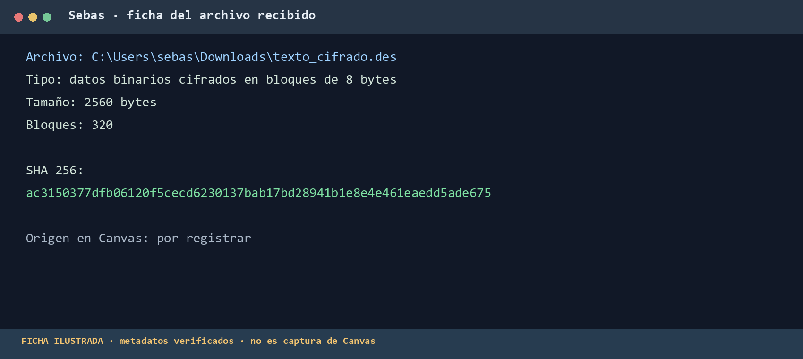

**Imagen 2. Resultado del descifrado local independiente.** La captura de la medición `Ts` con MPI continúa pendiente.

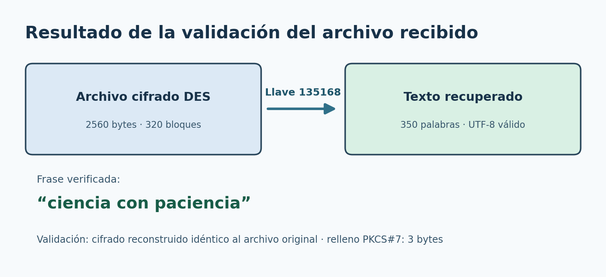

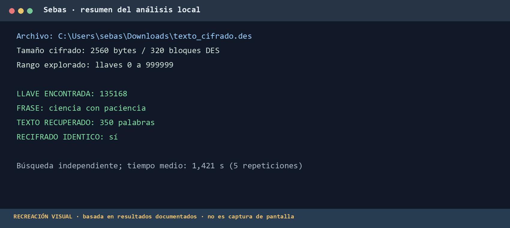

*La figura de consola es una recreación de resultados medidos; no es una captura directa de PowerShell.*

El archivo se probó mediante una búsqueda local independiente en el rango de 0 a 999999, usando la misma conversión de enteros a llaves DES de 56 bits que implementa el programa del repositorio. La llave 135168 produjo el texto «La computación paralela permite resolver problemas...». Tras descifrar todo el archivo, retirar el relleno y verificar la frase `ciencia con paciencia`, se cifró de nuevo el resultado y se obtuvo exactamente la secuencia original de 2560 bytes. El texto recuperado se entrega como `texto_descifrado_externo.txt`.

La búsqueda independiente comprobó primero 24 bytes por candidata y solo descifró el texto completo cuando ese prefijo era legible. Sus cinco tiempos fueron 1,388; 1,337; 1,416; 1,575 y 1,388 segundos. Este tiempo describe ese procedimiento en Python; no sustituye el `Ts` que la consigna pide medir con el programa paralelizado.

### 3.1 Validación local disponible

La prueba local efectuada con la imagen del proyecto ejecutó cuatro procesos MPI con `--key 63 --limit 256` y terminó con `LLAVE=63` y `VERIFICACION=CORRECTA`. Esta prueba valida el programa y la imagen con el texto propio, pero no equivale a ejecutar `bruteforce_mpi` sobre el archivo recibido.

La bitácora del proyecto también anota un tiempo para otra prueba de descifrado. No se utiliza como `Ts` de esta entrega porque corresponde a una medición distinta de la búsqueda sobre `texto_cifrado.des` documentada aquí.

## 4. Preparación y validación con Docker

El `Dockerfile` parte de `ubuntu:22.04` e instala `build-essential`, `openmpi-bin`, `libopenmpi-dev`, `openssh-server`, `openssh-client` y `libssl-dev`. Durante la construcción compila `bruteforce_.c` con `gcc` y `bruteforce_mpi.c` con `mpicc`, ambos enlazados con `libcrypto`. Los binarios y `texto_plano.txt` quedan en `/app`.

El servidor SSH del contenedor permite iniciar sesión como `root` mediante clave pública y deshabilita la autenticación por contraseña. El cliente configura `StrictHostKeyChecking no` para el laboratorio. Las variables `OMPI_ALLOW_RUN_AS_ROOT` y `OMPI_ALLOW_RUN_AS_ROOT_CONFIRM` permiten ejecutar OpenMPI dentro del contenedor como `root`. La configuración emplea claves generadas al iniciar el nodo; la clave privada no forma parte de la imagen.

| Validación solicitada | Resultado registrado | Ajuste o procedimiento |
|---|---|---|
| `mpicc --version` dentro de la imagen | Identificó GCC 11.4.0 en la validación documentada del repositorio. | Instalar `build-essential` y `libopenmpi-dev`. |
| `mpirun -np 2 echo "Proceso MPI ejecutado"` | Imprimió el mensaje dos veces en la validación documentada. | Definir las dos variables de entorno que habilitan MPI como `root`. |
| Abrir `/bin/bash` en el contenedor | La imagen incluye Bash y el punto de entrada lo ejecuta cuando no recibe otro comando. | Construir la imagen antes de crear el contenedor. |
| Servicio SSH activo | El nodo de Compose informó `healthy`; `check-ssh.sh localhost` devolvió el nombre del contenedor. | El punto de entrada inicia `sshd`; no hace falta ejecutar `service ssh start` otra vez en ese contenedor. |
| Clave pública y SSH local sin contraseña | La validación documentada obtuvo una conexión SSH local con clave; en la sesión actual también funcionó `check-ssh.sh localhost`. | `init-ssh.sh` crea la clave si falta y agrega su pública a `authorized_keys`. |
| Búsqueda MPI local | La prueba con cuatro procesos recuperó la llave 63 y mostró `VERIFICACION=CORRECTA`. | Ejecutar desde `/app`, donde se encuentra `texto_plano.txt`. |

**Imagen 3. Construcción y versiones registradas en la validación local.**

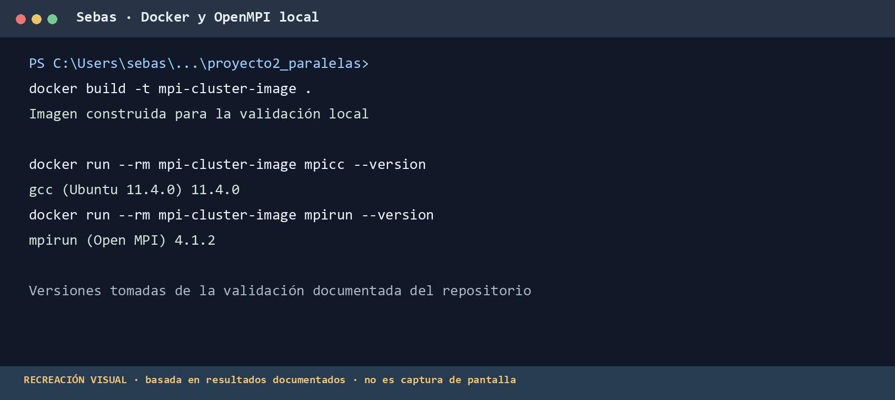

**Imagen 4. Prueba MPI local con cuatro procesos.**

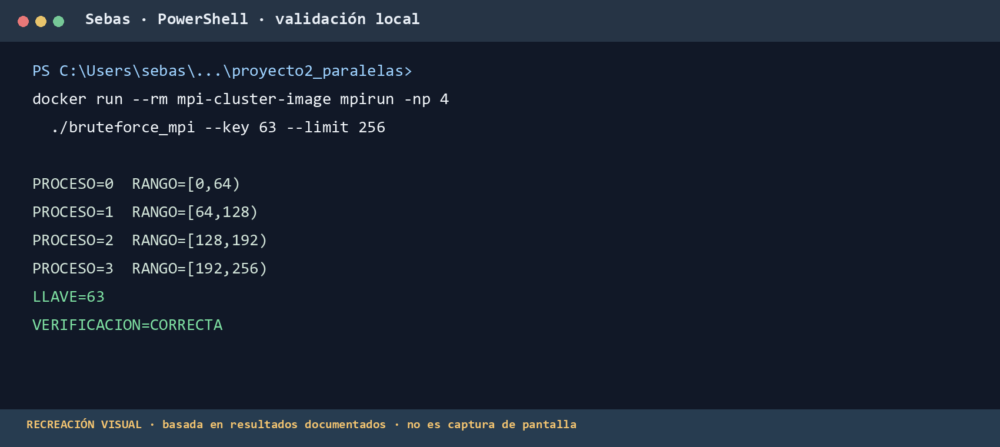

*La figura de consola resume el resultado local informado durante el trabajo; no es una captura directa de PowerShell.*

### 4.1 Alcance de la portabilidad

Docker estandariza el sistema operativo y las bibliotecas, pero una imagen construida para `amd64` no convierte automáticamente sus ejecutables en binarios `arm64`. Si el grupo mezcla arquitecturas, debe construir una variante compatible en cada equipo y verificar la compatibilidad de OpenMPI y de los datos intercambiados.

## 5. Topología de red y diagnóstico

La topología prevista consta de tres computadoras conectadas al mismo enrutador. Cada una ejecuta un contenedor con la imagen del proyecto. Una computadora actúa como nodo maestro y las otras dos como trabajadores. El archivo `cluster_hosts` debe contener las direcciones alcanzables de los nodos, con `slots` y `max_slots` acordes con sus recursos reales. Las IP ilustrativas `192.168.1.10` y `192.168.1.11` del repositorio no identifican a los equipos del grupo.

```text
Computadora maestra ── enrutador LAN ── computadora trabajadora 1
                         │
                         └──────────── computadora trabajadora 2
```

**Imagen 5. Topología de tres computadoras.** Las IP, los sistemas operativos y los recursos concretos deben incorporarse tras confirmarlos en cada equipo.

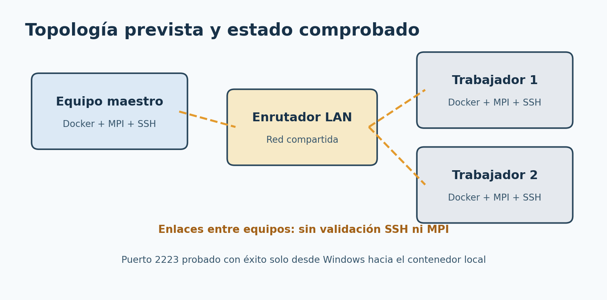

### 5.1 Incidente observado en Windows y WSL

En la computadora de Sebastián, el contenedor figuraba como `Up` y `healthy`, y `docker compose port nodo 22` mostraba la publicación `0.0.0.0:2222`. `check-ssh.sh localhost` funcionaba dentro del contenedor. Sin embargo, `Test-NetConnection 127.0.0.1 -Port 2222` devolvía `TcpTestSucceeded : False` y Windows no mostraba un proceso escuchando en ese puerto. Repetir la publicación en el puerto 2223 produjo el mismo fallo.

El diagnóstico de Docker registró el reenvío configurado hacia `172.18.0.2:22`, mientras que la lista de conexiones de Windows no mostraba un listener en el puerto 2223. La configuración global de WSL tenía `networkingMode=mirrored`. Tras cambiarla a `networkingMode=nat`, cerrar WSL y reiniciar Docker Desktop, la prueba local del puerto 2223 devolvió `TcpTestSucceeded : True`. El cambio de modo de red resolvió la conectividad entre Windows y el puerto publicado en esa computadora. La documentación de Microsoft reconoce problemas entre el modo reflejado de WSL y puertos publicados de contenedores Docker.

**Imagen 6. Resultado local del puerto SSH después del cambio de red de WSL.**

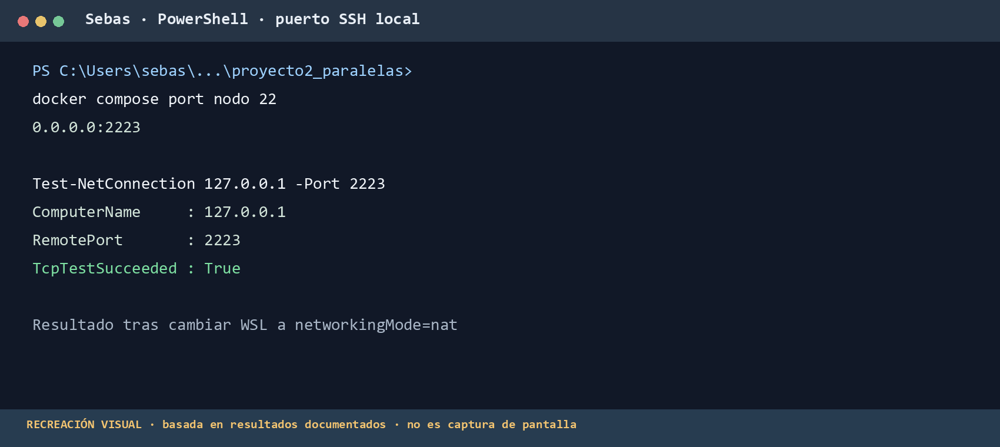

*La figura de consola representa el resultado posterior al cambio a NAT; no es una captura directa de PowerShell.*

### 5.2 Estado entre computadoras

La prueba de conexión entre las tres computadoras de la LAN no llegó a funcionar durante la sesión registrada. Por consiguiente, no hay evidencia de autenticación SSH entre nodos, de ejecución `mpirun --hostfile` con nombres de equipos distintos ni de intercambio MPI entre las tres computadoras. El estado `healthy` únicamente demuestra que SSH responde dentro del contenedor; tampoco la prueba `Test-NetConnection` local demuestra accesibilidad desde otra computadora.

Para continuar, cada equipo debe confirmar su IP de Wi-Fi o Ethernet, comprobar desde los otros dos equipos el puerto publicado, permitir el tráfico entrante necesario en el firewall del destino y verificar que el enrutador no aísle a los clientes. Después deben intercambiar solo las claves SSH públicas, probar `check-ssh.sh IP_DESTINO PUERTO` desde cada origen y ejecutar `mpirun --hostfile ... hostname` antes de lanzar el algoritmo. SSH por sí solo no valida las conexiones de datos y control que abre OpenMPI.

**Imagen 7. Comandos para comprobar la conexión entre las computadoras.**

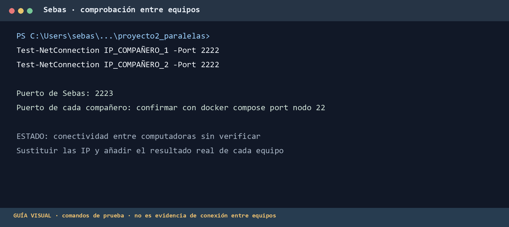

**Imagen 8. Secuencia para autorizar y probar SSH entre nodos.**

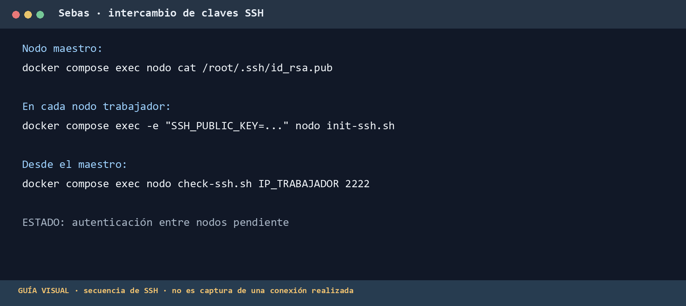

**Imagen 9. Ejemplo de `cluster_hosts` y prueba de nombres de nodo.** Las direcciones mostradas son ilustrativas.

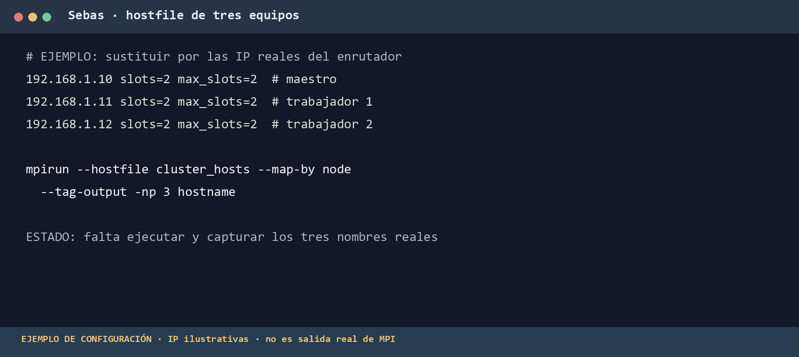

**Imagen 10. Secuencia prevista para validar el ataque distribuido.** La salida real de los tres nodos debe registrarse cuando la red funcione.

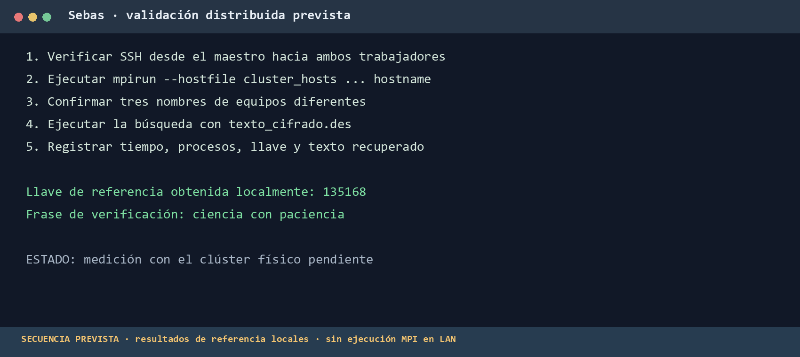

## 6. Rendimiento y comparación

La campaña de la primera parte contiene 150 ejecuciones: cinco llaves, cinco repeticiones por combinación y ejecuciones secuenciales y MPI con 1, 2, 4, 8 y 16 procesos. El archivo `resultados/entorno.txt` registra un AMD Ryzen AI 7 350 con ocho núcleos físicos y 16 hilos lógicos. El cronómetro mide solo el ciclo de búsqueda; no incluye la lectura del archivo ni el cifrado inicial.

| Llave | Tiempo secuencial medio | MPI, 2 procesos | MPI, 4 procesos | MPI, 8 procesos | MPI, 16 procesos |
|---:|---:|---:|---:|---:|---:|
| 4095 | 0,125 s | 0,180 s | 0,182 s | 0,184 s | 0,148 s |
| 262144 | 4,384 s | 0,115 s | 0,184 s | 0,185 s | 0,154 s |
| 524287 | 8,840 s | 6,671 s | 3,543 s | 1,941 s | 1,163 s |

Estos resultados corresponden a **una computadora y al texto propio**, no al clúster de tres máquinas. Para la llave 524287, la búsqueda recorre hasta el final del intervalo y el speedup local con 16 procesos es `8,840 / 1,163 ≈ 7,60`. El caso 262144 arroja un speedup aparente mucho mayor porque la llave queda al comienzo del rango de otro proceso: cambia la cantidad de candidatas del camino crítico, por lo que no constituye una medición limpia de escalado.


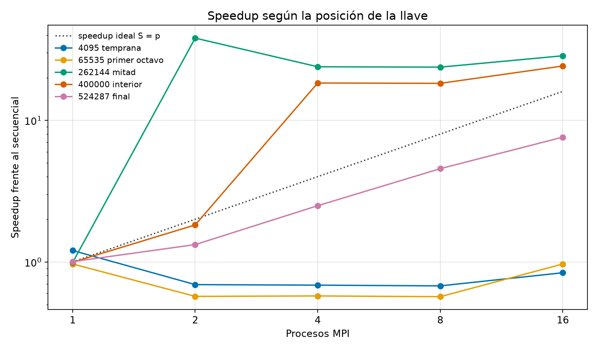

| Comparación requerida para la parte 2 | Tiempo | Speedup frente a `Ts` |
|---|---:|---:|
| Descifrado cruzado local, texto de otro grupo | Pendiente | 1,00 por definición |
| Descifrado cruzado en tres computadoras | Pendiente | Pendiente |

La llave del archivo recibido ya se conoce y el contenido fue verificado de forma independiente. Falta ejecutar la versión MPI sobre ese archivo para obtener un `Ts` directamente comparable con la futura medición del clúster.

El speedup distribuido debe calcularse como `S = Ts / Tcluster` y la eficiencia como `E = S / p`, donde `p` es el número total de procesos. No es correcto sustituir `Ts` con una medición del texto propio ni comparar tiempos de llaves o límites diferentes. En un clúster físico también deben contabilizarse la latencia de las colectivas, las diferencias de velocidad entre nodos y el coste de arranque remoto. Como el programa sincroniza cada 4096 candidatas, una llave encontrada muy pronto puede quedar dominada por estos costes; una búsqueda larga ofrece más trabajo con el cual amortizarlos.

**Imagen 11. Estado de los datos para comparar la ejecución local y la distribuida.**

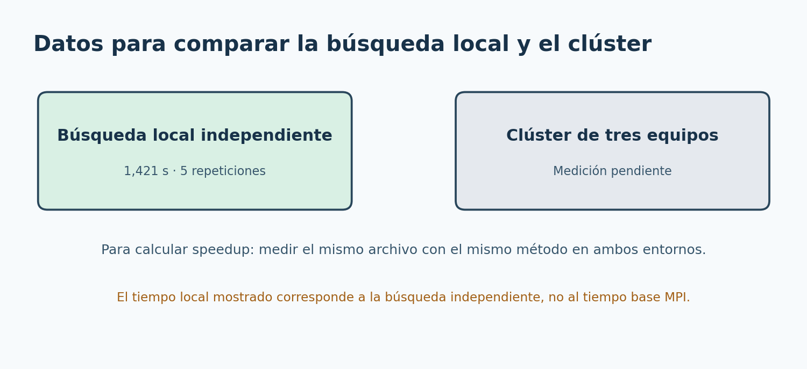

## 7. Respuestas a las preguntas de discusión

### 7.1 ¿Por qué OpenMPI puede quedarse esperando si no se limita la interfaz TCP?

OpenMPI 4 descubre las interfaces IP activas y puede intentar comunicarse por varias redes. `docker0` y las redes `172.x.x.x` de Docker suelen ser redes privadas de cada anfitrión: una dirección de ese tipo en la computadora A no necesariamente tiene una ruta desde la computadora B y podría incluso repetirse en ambos equipos. Si un proceso anuncia esa dirección y otro intenta conectarse a ella, la conexión falla o permanece esperando hasta agotar sus tiempos de espera. El problema puede presentarse durante la coordinación del lanzamiento o cuando una llamada colectiva, como `MPI_Allreduce`, necesita mensajes de un proceso remoto. `btl_tcp_if_include` restringe el transporte TCP de datos y `oob_tcp_if_include` restringe el tráfico de control a una red alcanzable en todos los nodos. Debe indicarse la subred real, no copiar una dirección de ejemplo. La ausencia del filtro no implica que *toda* ejecución se congele; el resultado depende de las interfaces y rutas elegidas.

### 7.2 ¿Qué problemas de red enfrentó el equipo?

El problema comprobado fue la falta de acceso desde Windows a un puerto que Docker Desktop mostraba como publicado. La comprobación interna de SSH funcionaba, mientras que la conexión TCP a `127.0.0.1:2222` y luego a `127.0.0.1:2223` fallaba. El diagnóstico mostró que Docker había registrado la regla de reenvío, y la inspección de Windows no halló un proceso escuchando en el puerto. Cambiar WSL de red reflejada a NAT y reiniciar el entorno restableció la prueba local en el puerto 2223. Aún no se ha aislado la causa de la falla entre las tres computadoras; corresponde verificar IP, perfil de red, firewall y posible aislamiento de clientes en el enrutador.

### 7.3 ¿Cómo se comparan el tiempo local y el del clúster físico?

La comparación solicitada no puede calcularse todavía: el archivo recibido ya se descifró con una búsqueda local independiente, pero falta medirlo con el programa MPI y ejecutarlo en el clúster. Los tiempos de la sección 6 documentan únicamente el comportamiento de la primera parte en una máquina. Una comparación válida exige registrar `Ts`, `Tcluster`, el número de procesos, el reparto por nodo y varias repeticiones bajo la misma carga. Si `Tcluster < Ts`, habrá speedup; si `Tcluster > Ts`, los costes de red, coordinación o el desequilibrio de hardware habrán superado el beneficio del paralelismo.

### 7.4 ¿Qué ocurre con 32 procesos MPI en una computadora de cuatro núcleos?

Habría ocho procesos por núcleo físico. Al competir por tiempo de CPU, caché y ancho de banda de memoria, aumentan los cambios de contexto y el tiempo de espera. El algoritmo es intensivo en CPU, así que añadir procesos muy por encima de los recursos disponibles difícilmente mejora el rendimiento y puede empeorarlo. Si `max_slots` limita el nodo a cuatro procesos y no se habilita sobresuscripción, OpenMPI rechazará el lanzamiento de 32 procesos; ese rechazo evita interpretar un resultado sobresuscrito como una mejora real del clúster. El ajuste debe reflejar los recursos efectivos del equipo y la política de asignación de núcleos o hilos.

### 7.5 ¿Qué vulnerabilidades y retos logísticos presenta un clúster heterogéneo?

La administración debe coordinar versiones compatibles de OpenMPI, bibliotecas, ejecutables, arquitectura de CPU, archivos de entrada y rutas de trabajo. También necesita identificar la interfaz correcta de cada nodo, gestionar IP que pueden cambiar, configurar firewall para SSH y tráfico MPI, y evitar rutas virtuales no alcanzables. Las claves SSH privadas requieren protección y distribución controlada de sus claves públicas. La configuración de laboratorio permite acceso `root` por clave y desactiva la verificación de huellas SSH; estas decisiones simplifican la práctica, pero reducen las garantías frente a errores de identidad del servidor o uso indebido de credenciales. Finalmente, la velocidad desigual de los equipos, la latencia y los fallos de un nodo pueden retrasar a todos los procesos que participan en una colectiva.

### 7.6 ¿Se logró el objetivo y qué se mejoraría?

Se logró construir y validar el entorno Docker, ejecutar el algoritmo MPI localmente, iniciar SSH en el contenedor, resolver el fallo de publicación del puerto y recuperar la llave y el texto del archivo recibido mediante una verificación local independiente. El objetivo de descifrar ese texto mediante tres computadoras físicas **todavía no está demostrado**. La parte más satisfactoria fue convertir un fallo de red poco visible en una secuencia de pruebas y confirmar la llave mediante un recifrado idéntico. La parte menos satisfactoria fue que un contenedor `healthy` no garantizaba acceso desde el anfitrión ni desde la LAN. Para mejorar el procedimiento, conviene fijar desde el inicio una topología de red comprobable, registrar IP y puertos por equipo, validar SSH entre pares antes de MPI y usar una prueba `hostname` distribuida antes de medir rendimiento.

## 8. Conclusiones

La imagen Docker reproduce las dependencias y el programa funciona con cuatro procesos MPI en una sola computadora. Se recuperó la llave 135168 de `texto_cifrado.des`, se obtuvo un texto plano de 350 palabras y se confirmó el resultado recifrando byte por byte el archivo. La prueba de red mostró que el estado de Docker y la salud interna de SSH no bastan para demostrar conectividad externa; la publicación efectiva del puerto debe verificarse desde Windows y desde los otros equipos. El cambio de WSL a NAT restableció la conexión local al puerto 2223, pero la comunicación entre las tres computadoras y la ejecución MPI distribuida siguen pendientes. Los resultados de rendimiento existentes describen la primera parte; todavía se requiere medir el archivo externo con la versión MPI para comparar los tiempos local y distribuido.

## Referencias

1. Universidad del Valle de Guatemala. *Proyecto #2 Parte 2 - HPC con OpenMPI colectivo*. Consigna del curso CC3069, semestre II de 2026.
2. Repositorio del equipo: `README.md`, `Dockerfile`, `compose.yaml`, `bruteforce_mpi.c`, `docker/README.md`, `docker/CONEXION_LAN.md`, `resultados/resumen.csv` y `resultados/entorno.txt`.
3. Open MPI. [FAQ de comunicaciones TCP en Open MPI 4](https://www.open-mpi.org/faq/?category=tcp).
4. Docker. [Funcionamiento de la red y la publicación de puertos en Docker Desktop](https://docs.docker.com/desktop/features/networking/).
5. Microsoft. [Problemas conocidos de WSL y redes reflejadas](https://learn.microsoft.com/en-us/windows/wsl/troubleshooting).
