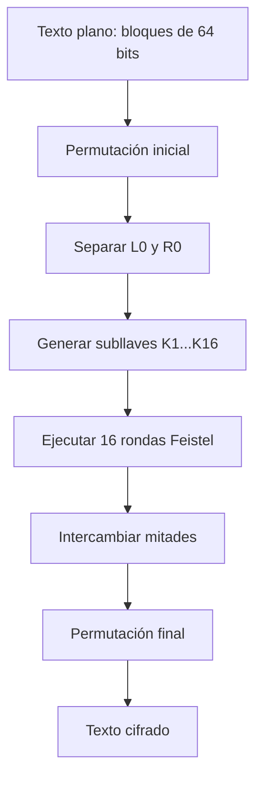
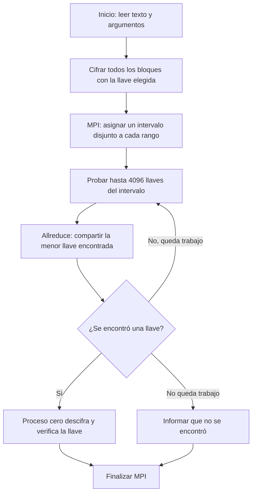
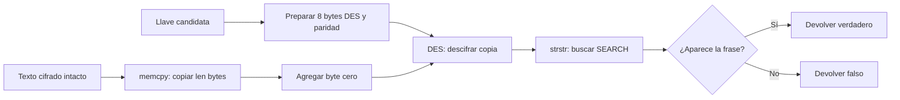
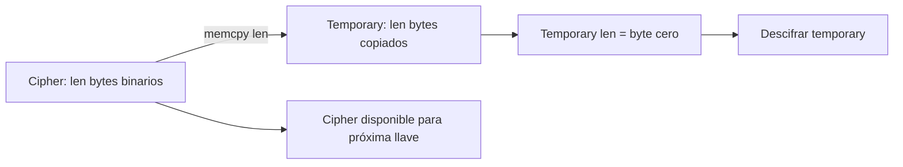
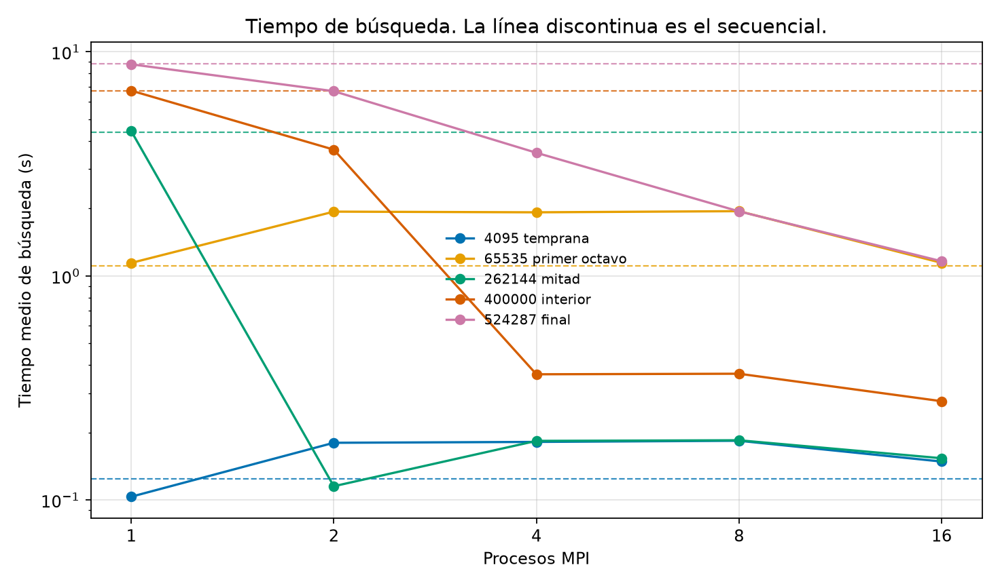
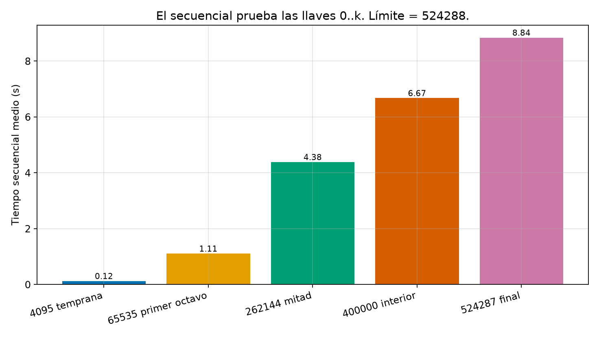
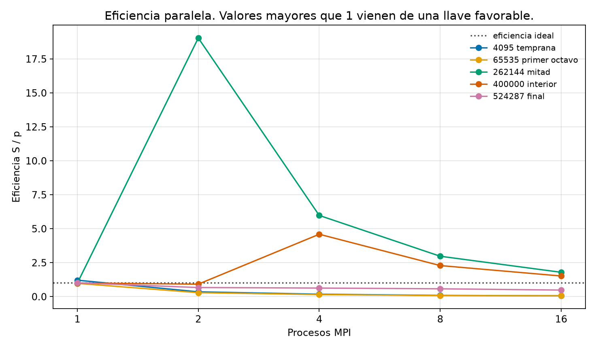

# Informe

# Investigación y documentación de DES

## Funcionamiento de DES

DES (Data Encryption Standard) es un algoritmo simétrico de cifrado por bloques. Utiliza una llave de 64 bits, de los cuales 56 son efectivos y 8 se emplean para paridad. El texto se divide en bloques de 64 bits, equivalentes a 8 bytes.

Cada bloque pasa por:

1. Permutación inicial.
2. División en dos mitades de 32 bits: izquierda y derecha.
3. Dieciséis rondas Feistel.
4. Intercambio de las mitades.
5. Permutación final.

En cada ronda, la mitad derecha se expande de 32 a 48 bits, se combina mediante XOR con una subllave, atraviesa las cajas S y la permutación P. Luego se combina con la mitad izquierda para generar la nueva mitad derecha.

Para descifrar se utiliza el mismo procedimiento, pero aplicando las subllaves en orden inverso.

## Diagrama de flujo de DES



## Función `encrypt(key, *ciph, len)`

En la implementación actual, la función recibe una llave numérica, un puntero al búfer de texto y su longitud:

```c
encrypt(uint64_t key, char *text, size_t len)
```

Primero convierte la llave efectiva de 56 bits en ocho bytes compatibles con DES. Después establece los bits de paridad mediante `des_setparity`. Finalmente llama a `ecb_crypt` con el modo `DES_ENCRYPT`. La función cifra todos los bloques del búfer y modifica directamente el contenido original.

## Función `decrypt(key, *ciph, len)`

`decrypt` realiza el mismo procedimiento de preparación de la llave, pero llama a `ecb_crypt` usando `DES_DECRYPT`. El búfer cifrado se transforma nuevamente en texto plano. La función devuelve un valor verdadero si la operación termina correctamente y falso si ocurre un error.

## Documentación del proceso de cifrado 

El programa inicia leyendo el archivo `texto_plano.txt` en modo binario. Esto permite conservar exactamente los bytes del mensaje. Luego calcula una longitud múltiplo de ocho, porque DES cifra bloques de 64 bits, equivalentes a ocho bytes. Si el texto no completa el último bloque, se agregan espacios hasta alcanzar ese tamaño y se reserva un byte adicional para el terminador de cadena.

Antes de llamar a la biblioteca DES, `encrypt` recibe la llave candidata, el puntero al búfer y su longitud. La función delega en `crypt_buffer` con el modo `DES_ENCRYPT`. Allí `key_to_des` separa la llave numérica en ocho grupos de siete bits, los coloca en los bytes correspondientes y desplaza cada grupo para dejar espacio al bit de paridad. Después `des_setparity` calcula y establece la paridad requerida por DES. Finalmente, `ecb_crypt` procesa el búfer completo en bloques de ocho bytes. Cada bloque pasa por la permutación inicial, las dieciséis rondas Feistel y la permutación final; el resultado reemplaza el texto original en memoria.

Durante una ronda Feistel, el bloque se divide en mitades izquierda y derecha de 32 bits. La mitad derecha se expande a 48 bits, se combina mediante XOR con una subllave, atraviesa las cajas S y la permutación P. Ese resultado se combina con la mitad izquierda para producir la nueva derecha, mientras la derecha anterior se convierte en la nueva izquierda. Las subllaves se usan en orden ascendente durante el cifrado.

Para descifrar, `decrypt` repite exactamente la preparación de la llave y llama a `crypt_buffer` con `DES_DECRYPT`. DES conserva la misma estructura de rondas, pero utiliza las subllaves en orden inverso. Por eso el búfer cifrado puede restaurarse sin implementar un algoritmo diferente. En la búsqueda de fuerza bruta, `try_key` copia primero el cifrado, aplica `decrypt` a la copia y busca la frase conocida. Si la encuentra, la llave se considera válida. Finalmente, el proceso cero descifra el búfer original con la llave ganadora y muestra el texto recuperado.

Ambas funciones devuelven uno si `ecb_crypt` finaliza correctamente y cero si ocurre un error; por eso el programa puede detectar fallos durante el procesamiento del búfer cifrado.

# Implementación y análisis del código

## Preparación del programa y del texto de prueba

El archivo `texto_plano.txt` contiene 355 palabras y 2192 bytes. Incluye literalmente `la busqueda distribuida termina cuando aparece la frase clave`, que es la constante `SEARCH` usada por ambos programas. El texto se lee en modo binario y se rellena con espacios hasta una longitud múltiplo de ocho bytes, requisito de los bloques DES. Se reserva además un byte `\0` fuera de la longitud cifrada. En este caso, 2192 ya es múltiplo de ocho.

Se corrigió `bruteforce_.c` como referencia secuencial: lee el mismo archivo que la versión MPI, cifra **todos** sus bloques, prueba las llaves del intervalo `[0, limite)` y muestra la llave y el texto recuperado. El código inicial tenía una llave fija de valor `2^54`, cifraba únicamente 16 bytes y comprobaba una frase que no aparecía en esos 16 bytes; así no permitía una prueba breve y válida con este texto. Ambos programas aceptan `--key N` y `--limit N`; por defecto usan llave 900000 y límite 1000000. Se exige `0 <= llave < limite <= 2^56`, porque DES tiene 56 bits efectivos de llave. El límite reducido hace reproducible la demostración: recorrer el espacio completo de DES no es una prueba práctica.

En un entorno Linux con compiladores y bibliotecas de OpenMPI y libtirpc instalados, desde el directorio que contiene `texto_plano.txt` se pueden usar:

```bash
mpicc -std=c11 -O2 -Wall -Wextra -I/usr/include/tirpc bruteforce_.c -ltirpc -o bruteforce_serial
mpicc -std=c11 -O2 -Wall -Wextra -I/usr/include/tirpc bruteforce_mpi.c -ltirpc -o bruteforce_mpi
./bruteforce_serial --key 63 --limit 256
mpirun -np 4 ./bruteforce_mpi --key 63 --limit 256
```

La primera orden usa `mpicc` también para el programa secuencial por comodidad; ese archivo no llama a MPI y puede compilarse con `cc` si encuentra los mismos encabezados y bibliotecas DES. La ruta de inclusión puede variar según la instalación. Se debe comprobar `LLAVE=63`, `VERIFICACION=CORRECTA` y que `TEXTO_DESCIFRADO` contenga el mensaje de entrada. Para probar distintos segmentos del reparto, son útiles `--key 0 --limit 8192`, `--key 4097 --limit 8192` y `--key 8191 --limit 8192` con cuatro procesos. Con ese límite, los intervalos esperados son `[0,2048)`, `[2048,4096)`, `[4096,6144)` y `[6144,8192)`.

## Paralelización mediante OpenMPI

`MPI_Init` crea la ejecución distribuida; `MPI_Comm_size` obtiene el número de procesos y `MPI_Comm_rank` identifica cada proceso. Cada rango carga el mismo texto plano y lo cifra con la llave indicada, de modo que todos prueban exactamente el mismo texto cifrado. Esto supone acceso al archivo desde cada proceso. El espacio `[0, limite)` se divide en intervalos contiguos y **disjuntos**. Si `base = limite / procesos` y `extra = limite % procesos`, cada uno de los primeros `extra` procesos recibe una llave adicional. Así se cubren todas las llaves sin omisiones ni duplicaciones, incluso cuando el límite no es divisible entre procesos.

Dentro de su intervalo, cada proceso ejecuta `try_key` para cada candidata. Tras cada bloque de hasta 4096 candidatas, todos participan en `MPI_Allreduce` con `MPI_MIN`. El valor especial `UINT64_MAX` significa «todavía no se encontró». Si algún proceso halló una llave, la reducción devuelve la menor llave encontrada a todos los procesos y todos salen del ciclo en el mismo punto de sincronización. Los procesos que terminaron su intervalo siguen participando en las colectivas hasta que los demás terminen o aparezca una llave; esto evita que un proceso quede esperando solo. `MPI_Reduce` obtiene el máximo tiempo local, que representa el tiempo total de la fase paralela. El proceso cero descifra, imprime el resultado y compara la llave hallada con la llave usada para cifrar.



## Función `tryKey(key, *ciph, len)`

En `bruteforce_.c` la función se llama `tryKey`; en `bruteforce_mpi.c` se llama `try_key`. Ambas reciben una llave numérica candidata, un puntero de solo lectura al texto cifrado y su longitud en bytes. Devuelven verdadero únicamente si DES pudo descifrar y `strstr` localizó la frase `SEARCH` en el resultado. `key_to_des` distribuye los 56 bits efectivos en ocho bytes y `des_setparity` establece los bits de paridad. `crypt_buffer` llama a `ecb_crypt` con `DES_DECRYPT | DES_SW`, aplicando DES a todos los bloques. El texto cifrado original permanece intacto para la siguiente candidata.

La función crea `temporary[len + 1]`, copia `len` bytes del cifrado, escribe el terminador `temporary[len] = '\0'`, descifra **solo** la copia y busca la frase. El terminador es necesario para usar una función de cadenas tras el descifrado. Si una llave equivocada produce por casualidad un byte cero antes de la frase, `strstr` no verá el resto, lo cual es adecuado para descartar esa candidata. La aparición accidental de toda la frase con otra llave es extremadamente improbable; además, la salida compara explícitamente la llave recuperada con la usada para cifrar. El arreglo temporal está en la pila, por lo que esta implementación supone un texto de tamaño moderado.



## Función `memcpy()`

`memcpy(destino, origen, cantidad)` copia exactamente `cantidad` **bytes** de `origen` a `destino` y devuelve `destino`. No interpreta caracteres ni añade `\0`. Por eso se copia `len` y se escribe el terminador por separado. `temporary` tiene capacidad `len + 1`, y `cipher` conserva al menos `len` bytes válidos. Los rangos de origen y destino no se superponen; si se superpusieran, correspondería `memmove`. En este programa la copia evita que el intento de una llave destruya el cifrado que necesitan los intentos siguientes. Como el cifrado puede contener bytes cero, una copia basada en `strlen` o `strcpy` sería incorrecta.



## Función `strstr()`

`strstr(cadena, subcadena)` devuelve un puntero al primer lugar donde aparece `subcadena`, o `NULL` si no aparece. Exige que ambos argumentos sean cadenas terminadas en cero; no recibe una longitud y no sirve para buscar directamente dentro del cifrado binario. Aquí se llama después de descifrar y después de garantizar `temporary[len] = '\0'`. La expresión `strstr(temporary, SEARCH) != NULL` convierte el resultado en una condición booleana. Encontrar la frase conocida actúa como criterio de reconocimiento del texto recuperado; no cambia ni copia el texto.

## Verificación y límites de esta ejecución

Se revisaron el tamaño y el contenido de `texto_plano.txt`: tiene 355 palabras, 2192 bytes, longitud múltiplo de ocho y la frase exacta de búsqueda. Una comprobación independiente con la implementación DES de OpenSSL descifró el texto cifrado para las llaves 0, 63 y 255, buscó la misma frase entre las candidatas `[0,256)` y obtuvo respectivamente las llaves 0, 63 y 255. En los tres casos los 2192 bytes recuperados coincidieron con los bytes originales. Esta comprobación valida los datos de entrada, la transformación de la llave y el criterio de búsqueda; **no equivale a ejecutar los programas C**.

En el entorno usado para esta revisión no están disponibles `mpicc`, `mpirun` ni el encabezado `rpc/des_crypt.h`. Además, la instalación local de GCC termina con error incluso al compilar un programa mínimo, por lo que no fue posible compilar ni ejecutar `bruteforce_.c` o `bruteforce_mpi.c` aquí. Las órdenes anteriores quedan preparadas para repetir la compilación y verificar la ejecución MPI en un equipo con esas dependencias. Los tiempos y el speedup deben medirse allí; no se presentan cifras de rendimiento no observadas.
## Corrección de compilación en WSL: biblioteca DES

Durante la compilación en WSL, el enlazador informó referencias indefinidas a `des_setparity` y `ecb_crypt`. Aunque `libtirpc-dev` proporciona el encabezado `rpc/des_crypt.h`, la biblioteca disponible en ese entorno no resolvió esas funciones. Se reemplazó ese backend por las funciones DES de OpenSSL en **ambos** programas: `DES_set_odd_parity`, `DES_set_key_unchecked` y `DES_ecb_encrypt`. `crypt_buffer` transforma cada bloque de ocho bytes y conserva el mismo esquema DES-ECB y la misma búsqueda de la frase conocida. Las explicaciones anteriores de `memcpy`, `strstr`, `tryKey` y la distribución MPI siguen describiendo el flujo; las referencias anteriores a `des_setparity` y `ecb_crypt` corresponden a la versión previa del backend.

Para la versión corregida, se instala `libssl-dev` y se enlaza con `-lcrypto`:

```bash
sudo apt install build-essential openmpi-bin libopenmpi-dev libssl-dev
gcc -std=c11 -O2 bruteforce_.c -lcrypto -o bruteforce_serial
mpicc -std=c11 -O2 bruteforce_mpi.c -lcrypto -o bruteforce_mpi
./bruteforce_serial --key 63 --limit 256
mpirun -np 4 ./bruteforce_mpi --key 63 --limit 256
```

Al compilar con OpenSSL 3 pueden aparecer avisos de API DES obsoleta; son advertencias de compilación y no errores de enlace. Se conserva DES aquí porque es el algoritmo solicitado para el ejercicio. La ejecución se debe realizar desde el directorio donde se encuentra `texto_plano.txt`.
### Resultado de la compilación y ejecución real en WSL

Después de instalar `libssl-dev` en WSL (Ubuntu), se compilaron correctamente `bruteforce_.c` con `gcc` y `bruteforce_mpi.c` con `mpicc`, enlazando ambos con `-lcrypto`. OpenSSL 3 emitió únicamente avisos por las funciones DES obsoletas; los dos enlazados terminaron con código cero. Las pruebas se ejecutaron desde la carpeta del proyecto, con el archivo `texto_plano.txt` presente y el límite de 256 llaves.

| Llave usada | Secuencial | MPI con 4 procesos |
|---:|---|---|
| 0 | `LLAVE=0`, `VERIFICACION=CORRECTA`, salida 0 | `LLAVE=0`, `VERIFICACION=CORRECTA`, salida 0 |
| 63 | `LLAVE=63`, `VERIFICACION=CORRECTA`, salida 0 | `LLAVE=63`, `VERIFICACION=CORRECTA`, salida 0 |
| 255 | `LLAVE=255`, `VERIFICACION=CORRECTA`, salida 0 | `LLAVE=255`, `VERIFICACION=CORRECTA`, salida 0 |

La prueba MPI con llave 63 mostró los intervalos `[0,64)`, `[64,128)`, `[128,192)` y `[192,256)`. La observación anterior de que no se podían compilar o ejecutar los programas correspondía al entorno Windows inicial; esta prueba posterior en WSL la reemplaza. Los tiempos de esta prueba breve no constituyen una medición de rendimiento o speedup.

## Comparación explícita entre el código original y la versión adaptada

El `bruteforce_.c` entregado inicialmente fue el punto de partida, **pero no es el archivo que produjo los resultados de la tabla anterior**. Se reemplazó por una versión secuencial adaptada, cuyo código está actualmente en `bruteforce_.c`. La paralelización que se probó corresponde a `bruteforce_mpi.c`. Se deja esta distinción para no presentar una prueba de la versión adaptada como si fuera una ejecución del programa original.

| Aspecto | `bruteforce_.c` original  | Versión adaptada y probada |
|---|---|---|
| Entrada | Texto definido en el arreglo `eltexto` dentro del código. | Lee `texto_plano.txt`, el texto de 355 palabras usado en el proyecto. |
| Llave y rango | Llave fija `18014398509481984` (`2^54`) y búsqueda hasta `2^56`; sin parámetros para una prueba breve. | Parámetros `--key` y `--limit`, con rango acotado y validación `0 <= key < limit <= 2^56`. |
| Cifrado DES | `encrypt` y `decrypt` procesan solo 16 bytes, aunque `ciphlen` representa un texto más largo. | Prepara la longitud en bloques de ocho bytes y cifra o descifra **todos** los bloques. |
| Comprobación de llave | Busca ` los mismos del proyecto 1 `; esa frase aparece después de los primeros 16 bytes, que permanecían sin cifrar, por lo que encontrarla no demostraba que la llave probada fuera correcta. | Busca la frase de validación dentro del texto descifrado y compara la llave hallada con la utilizada para cifrar mediante `VERIFICACION=CORRECTA`. |
| Biblioteca DES | Llama a `des_setparity` y `ecb_crypt` del encabezado RPC. En este WSL, el enlace con `-ltirpc` dejó referencias indefinidas a ambas funciones. | Usa `DES_set_odd_parity`, `DES_set_key_unchecked` y `DES_ecb_encrypt` de OpenSSL, enlazadas con `-lcrypto`. |
| MPI | El original ya contenía llamadas MPI y asignaba grandes intervalos a procesos; no era una referencia secuencial. | `bruteforce_.c` quedó como referencia secuencial; `bruteforce_mpi.c` distribuye intervalos disjuntos y comunica los hallazgos mediante `MPI_Allreduce`. |

La modificación se hizo para poder comprobar el cifrado y la búsqueda con el **mismo archivo de texto**, evitar que una frase sin cifrar diera falsos positivos y disponer de llaves pequeñas que permitan repetir los ensayos. Al intentar compilar posteriormente una copia restaurada del original, también se observó un error de sintaxis porque el literal `eltexto` estaba cortado entre varias líneas sin concatenación válida en C. Esa copia no llegó a ejecutarse. Los resultados `LLAVE=0`, `LLAVE=63` y `LLAVE=255` documentados arriba corresponden exclusivamente a la versión adaptada y a `bruteforce_mpi.c`, ejecutadas en WSL; **no prueban el funcionamiento del código original sin cambios**.

Para reproducir las pruebas de la versión adaptada actual se compila `bruteforce_.c` con `gcc -std=c11 -O2 bruteforce_.c -lcrypto -o bruteforce_serial` y `bruteforce_mpi.c` con `mpicc -std=c11 -O2 bruteforce_mpi.c -lcrypto -o bruteforce_mpi`. Los comandos anteriores con `-ltirpc` documentan un intento previo y no corresponden al backend DES actual.

# Pruebas de rendimiento y análisis

## Diseño experimental

La búsqueda se detiene al encontrar la llave. Por eso el tiempo no depende solo de la cantidad de procesos: depende de cuántas candidatas alcanza a probar el programa antes de reconocer el texto. En `bruteforce_.c` ese recorrido es siempre `0, 1, 2, …` hasta la llave usada para cifrar. En `bruteforce_mpi.c` el intervalo `[0, limite)` se parte en rangos contiguos y cada proceso empieza en el inicio de su rango. Cada 4096 candidatas todos ejecutan `MPI_Allreduce`. El tiempo de muro lo marca el proceso más lento hasta el bloque en el que aparece la llave.

Se fijó el límite en 524288, múltiplo de 1, 2, 4, 8 y 16, para que los rangos queden parejos. Las cinco llaves cubren posiciones distintas dentro de ese reparto:

| Llave | Papel en el experimento |
|---:|---|
| 4095 | Última candidata del primer bloque de 4096. Queda en el rango del proceso 0 para cualquier cantidad de procesos. |
| 65535 | Final del primer octavo. Con 2, 4 y 8 procesos es la última llave del proceso 0. Con 16 procesos cae al final del proceso 1. |
| 262144 | Primera llave de la segunda mitad. Con 2 o más procesos es la primera llave de un rango posterior. |
| 400000 | Posición interior, sin coincidir con el borde de un rango. |
| 524287 | Última llave del límite. Obliga a recorrer el rango completo del último proceso. |

El dueño y el desplazamiento dentro de su rango quedan así:

| Procesos | 4095 | 65535 | 262144 | 400000 | 524287 |
|---:|---|---|---|---|---|
| 2 | rango 0, +4095 | rango 0, +65535 | rango 1, +0 | rango 1, +137856 | rango 1, +262143 |
| 4 | rango 0, +4095 | rango 0, +65535 | rango 2, +0 | rango 3, +6784 | rango 3, +131071 |
| 8 | rango 0, +4095 | rango 0, +65535 | rango 4, +0 | rango 6, +6784 | rango 7, +65535 |
| 16 | rango 0, +4095 | rango 1, +32767 | rango 8, +0 | rango 12, +6784 | rango 15, +32767 |

Cada combinación de programa, procesos y llave se ejecutó 5 veces. El tiempo registrado es solo el del ciclo de búsqueda: `timespec_get` en el secuencial y `MPI_Wtime` después de una barrera en MPI. La lectura de `texto_plano.txt` y el cifrado inicial quedan fuera del cronómetro. En las 150 ejecuciones la salida fue `VERIFICACION=CORRECTA`.

Las medias, las desviaciones y las gráficas se regeneran con:

```bash
gcc -std=c11 -O2 bruteforce_.c -lcrypto -o bruteforce_serial
mpicc -std=c11 -O2 bruteforce_mpi.c -lcrypto -o bruteforce_mpi
python3 benchmark/medir_rendimiento.py
```

El detalle de cada repetición está en `resultados/mediciones.csv` y las medias en `resultados/resumen.csv`.

## Entorno

Las mediciones se hicieron en el mismo equipo donde están los programas: un AMD Ryzen AI 7 350, con 8 núcleos físicos y 16 hilos. El sistema informa dos topes de reloj alternados. Los procesadores lógicos pares 0, 2, 4 y 6 llegan a 5.09 GHz. Los impares 1, 3, 5 y 7 se quedan en 3.51 GHz. El secuencial se fijó al procesador 0, uno de los núcleos rápidos. Hasta 8 procesos, MPI colocó un proceso por núcleo físico. Con 16 procesos colocó un proceso por hilo, así que cada núcleo ejecuta dos procesos.

Una comprobación aparte, fuera de las cinco repeticiones, midió el mismo trabajo de 262144 llaves en dos núcleos a la vez. El núcleo rápido terminó en 4.67 s, cerca de 5.05 GHz. El núcleo limitado a 3.51 GHz terminó en 7.10 s. Esa diferencia importa porque el `MPI_Allreduce` no deja avanzar al grupo más rápido que el proceso más lento.

## Tiempos medios

La tabla siguiente muestra la media de las cinco repeticiones y la desviación estándar muestral, en segundos.

| Llave | Secuencial | MPI 1 | MPI 2 | MPI 4 | MPI 8 | MPI 16 |
|---:|---:|---:|---:|---:|---:|---:|
| 4095 | 0.125 ± 0.001 | 0.103 ± 0.029 | 0.180 ± 0.002 | 0.182 ± 0.002 | 0.184 ± 0.001 | 0.148 ± 0.011 |
| 65535 | 1.105 ± 0.017 | 1.143 ± 0.079 | 1.935 ± 0.077 | 1.922 ± 0.059 | 1.945 ± 0.067 | 1.144 ± 0.046 |
| 262144 | 4.384 ± 0.018 | 4.428 ± 0.022 | 0.115 ± 0.024 | 0.184 ± 0.004 | 0.185 ± 0.002 | 0.154 ± 0.027 |
| 400000 | 6.675 ± 0.023 | 6.709 ± 0.013 | 3.659 ± 0.107 | 0.364 ± 0.002 | 0.366 ± 0.003 | 0.276 ± 0.007 |
| 524287 | 8.840 ± 0.030 | 8.796 ± 0.032 | 6.671 ± 0.048 | 3.543 ± 0.079 | 1.941 ± 0.047 | 1.163 ± 0.038 |

En el secuencial el tiempo sigue la posición de la llave. Probar hasta 4095 cuesta 0.125 s. Probar hasta 524287 cuesta 8.840 s, unas 59300 llaves por segundo sobre el texto de 2192 bytes. La llave 262144, que está a la mitad del recorrido, tarda 4.384 s, también cerca de la mitad.

Con un solo proceso MPI el resultado largo coincide con el secuencial: 8.796 s frente a 8.840 s en la llave final, y 6.709 s frente a 6.675 s en la llave 400000. La media de la llave 4095 con un proceso (0.103 s) tiene una desviación grande porque dos repeticiones bajaron a 0.069 s y 0.074 s y las otras tres se quedaron en 0.124 s. En una búsqueda tan corta el reloj del núcleo todavía está subiendo, y la media no debe leerse como una ventaja real de MPI.





## Speedup y eficiencia

El speedup se calculó contra el programa secuencial, que es la referencia de un solo núcleo rápido:

`S(p) = T_secuencial / T_mpi(p)`

La eficiencia es `E(p) = S(p) / p`. Un valor cercano a 1 significa que cada proceso aporta casi una parte proporcional del tiempo secuencial. Un valor mayor que 1 aparece cuando la versión paralela recorre menos candidatas en su camino crítico que el secuencial, no cuando un núcleo haga más trabajo por segundo.

| Llave | S(1) | S(2) | S(4) | S(8) | S(16) |
|---:|---:|---:|---:|---:|---:|
| 4095 | 1.20 | 0.69 | 0.69 | 0.68 | 0.84 |
| 65535 | 0.97 | 0.57 | 0.58 | 0.57 | 0.97 |
| 262144 | 0.99 | 38.07 | 23.89 | 23.74 | 28.55 |
| 400000 | 0.99 | 1.82 | 18.34 | 18.24 | 24.19 |
| 524287 | 1.01 | 1.33 | 2.50 | 4.56 | 7.60 |

| Llave | E(1) | E(2) | E(4) | E(8) | E(16) |
|---:|---:|---:|---:|---:|---:|
| 4095 | 1.20 | 0.35 | 0.17 | 0.08 | 0.05 |
| 65535 | 0.97 | 0.29 | 0.14 | 0.07 | 0.06 |
| 262144 | 0.99 | 19.03 | 5.97 | 2.97 | 1.78 |
| 400000 | 0.99 | 0.91 | 4.59 | 2.28 | 1.51 |
| 524287 | 1.01 | 0.66 | 0.62 | 0.57 | 0.48 |




## Cómo la llave cambia el tiempo y el speedup

Conviene separar dos cifras. La primera es el trabajo del secuencial, `llave + 1` candidatas. La segunda es el camino crítico paralelo: las candidatas que el proceso más lento alcanza a examinar antes de que el `Allreduce` avise que ya hubo un hallazgo. Quien no posee la llave completa el bloque de 4096. El cociente de esas dos cantidades es el speedup que correspondería si cada candidata costara lo mismo en ambos programas. La tabla lo llama speedup de trabajo y lo compara con el speedup medido.

| Llave | Procesos | Candidatas secuenciales | Camino crítico | Speedup de trabajo | Speedup medido |
|---:|---:|---:|---:|---:|---:|
| 4095 | 2 a 16 | 4096 | 4096 | 1.00 | 0.68 a 0.84 |
| 65535 | 2, 4 y 8 | 65536 | 65536 | 1.00 | 0.57 a 0.58 |
| 65535 | 16 | 65536 | 32768 | 2.00 | 0.97 |
| 262144 | 2, 4, 8 y 16 | 262145 | 4096 | 64.00 | 23.74 a 38.07 |
| 400000 | 2 | 400001 | 139264 | 2.87 | 1.82 |
| 400000 | 4, 8 y 16 | 400001 | 8192 | 48.83 | 18.24 a 24.19 |
| 524287 | 2 | 524288 | 262144 | 2.00 | 1.33 |
| 524287 | 4 | 524288 | 131072 | 4.00 | 2.50 |
| 524287 | 8 | 524288 | 65536 | 8.00 | 4.56 |
| 524287 | 16 | 524288 | 32768 | 16.00 | 7.60 |

La llave 65535 muestra el caso en que agregar procesos no reduce el camino crítico. Con 2, 4 u 8 procesos el dueño es el proceso 0 y tiene que probar las mismas 65536 candidatas que el secuencial. Los demás procesos avanzan esos mismos bloques antes de enterarse del hallazgo. El muro queda en 1.92 s a 1.95 s, por encima del secuencial (1.105 s), y el speedup se queda en 0.57. Solo al pasar a 16 procesos la llave entra en el segundo rango y el camino crítico baja a 32768 candidatas; el tiempo medio baja a 1.144 s.

La llave 262144 produce el speedup aparente. El secuencial prueba 262145 candidatas y tarda 4.384 s. Con dos o más procesos esa llave es la primera de un rango, así que aparece dentro del primer bloque de 4096. El tiempo paralelo baja a 0.115 s con 2 procesos y el speedup sube a 38, muy por encima de 2. La eficiencia de 19 no describe un núcleo 19 veces más productivo. Describe que el secuencial recorrió un prefijo de 262144 llaves que, en la versión paralela, queda repartido en otros rangos y se abandona en cuanto el primer `Allreduce` publica el hallazgo. Esos otros rangos apenas alcanzan a probar un bloque.

La llave 400000 enseña el mismo mecanismo en una posición que no es un borde exacto. Con 2 procesos el dueño todavía tiene 137856 llaves de desplazamiento y el speedup medido es 1.82, cerca del speedup de trabajo 2.87 y también cerca de la cantidad de procesos. Con 4 procesos el rango dueño empieza en 393216, el desplazamiento baja a 6784 y bastan dos bloques. El tiempo pasa de 3.659 s a 0.364 s y el speedup salta a 18.3. Subir de 4 a 8 procesos no cambia ese dueño ni ese desplazamiento, y el tiempo se mantiene en 0.366 s. La gráfica lo muestra como un escalón, no como una recta.

La llave 524287 es la comparación limpia de escalado. El camino crítico es el tamaño del rango, `524288 / p`, y el speedup de trabajo es exactamente `p`. El speedup medido crece con los procesos, de 1.33 a 7.60, y se mantiene por debajo de la recta ideal. Aquí sí tiene sentido hablar de eficiencia menor que 1: ambos programas recorren un trabajo proporcional y el paralelo no logra dividir el tiempo por `p`.

## Por qué el caso exhaustivo no alcanza el speedup ideal

En la llave final, un proceso MPI tarda prácticamente lo mismo que el secuencial. La distancia aparece al usar varios núcleos. Con 2 procesos el tiempo baja de 8.840 s a 6.671 s, un factor de 1.33 frente al factor 2 del reparto. Con 4, 8 y 16 procesos los factores son 2.50, 4.56 y 7.60.

El reparto de llaves de esa prueba es equilibrado: cada proceso examina la misma cantidad. El `Allreduce` de un solo proceso, repetido cada 4096 llaves a lo largo de toda la búsqueda, no explica la diferencia, porque MPI con un proceso ya incluye esas colectivas y aun así empata con el secuencial. La diferencia coincide con los dos relojes del equipo. El secuencial corre en un núcleo de 5.09 GHz. A partir de dos procesos el grupo incluye núcleos limitados a 3.51 GHz, y la barrera de cada bloque espera al más lento. El cociente de relojes máximos es 1.45. El cociente observado al repetir 262144 llaves en un núcleo rápido y en uno lento a la vez fue 1.52. Aplicado al caso de 2 procesos, la mitad del trabajo secuencial hecha al ritmo del núcleo lento da un tiempo del orden de 6.7 s, que es lo medido.

Con 8 procesos se ocupan los cuatro núcleos rápidos y los cuatro lentos. El muro lo siguen marcando los lentos, así que la eficiencia queda en 0.57. Con 16 procesos hay dos hilos por núcleo. El tiempo de la llave final pasa de 1.941 s a 1.163 s: mejora 1.67 veces, y la eficiencia baja a 0.48. El segundo hilo aporta trabajo, pero comparte el núcleo con el primero.

Las búsquedas cortas amplían otra holgura. El speedup de trabajo de la llave 262144 es 64 y el medido con 2 procesos es 38. El paralelo dura alrededor de 0.12 s, un intervalo en el que el reloj y el costo fijo del bloque pesan más que en una búsqueda de varios segundos. Aun con esa holgura, 38 sigue siendo un speedup de posición de la llave, no un speedup de los dos núcleos.

## Conclusiones

El secuencial tarda en proporción a la llave elegida: 0.125 s para 4095 y 8.840 s para 524287, con el texto completo de 2192 bytes. MPI con un proceso reproduce esos tiempos en las búsquedas largas.

Aumentar los procesos solo reduce el tiempo cuando la llave cae más cerca del inicio del rango que le toca. Por eso la misma corrida de 4 procesos tiene speedup 0.58 con la llave 65535 y speedup 23.89 con la llave 262144. Publicar un solo speedup, sin decir qué llave se usó, mezclaría esos dos fenómenos.

Cuando la llave está al final del espacio y el reparto sí es exhaustivo, el speedup crece con los procesos y se mantiene por debajo de `p`. En este equipo la causa principal es la mezcla de núcleos a 5.09 GHz y a 3.51 GHz, junto con la sincronización por bloques, que obliga a esperar al núcleo lento. Los 16 hilos mejoran el tiempo respecto de 8 procesos, con un rendimiento menor por hilo porque cada núcleo queda compartido.

Las 150 ejecuciones recuperaron la llave con la que se había cifrado el texto.
