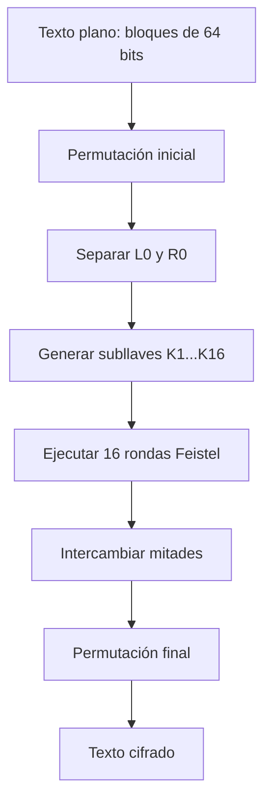

# Informe

# Investigación y documentación de DES

## Funcionamiento de DES

DES (Data Encryption Standard) es un algoritmo simétrico de cifrado por bloques. Utiliza una llave de 64 bits, de los cuales 56 son efectivos y 8 se emplean para paridad. El texto se divide en bloques de 64 bits, equivalentes a 8 bytes.

Cada bloque pasa por:

1. Permutación inicial.
2. División en dos mitades de 32 bits: izquierda y derecha.
3. Dieciséis rondas Feistel.
4. Intercambio de las mitades.
5. Permutación final.

En cada ronda, la mitad derecha se expande de 32 a 48 bits, se combina mediante XOR con una subllave, atraviesa las cajas S y la permutación P. Luego se combina con la mitad izquierda para generar la nueva mitad derecha.

Para descifrar se utiliza el mismo procedimiento, pero aplicando las subllaves en orden inverso.

## Diagrama de flujo de DES



## Función `encrypt(key, *ciph, len)`

En la implementación actual, la función recibe una llave numérica, un puntero al búfer de texto y su longitud:

```c
encrypt(uint64_t key, char *text, size_t len)
```

Primero convierte la llave efectiva de 56 bits en ocho bytes compatibles con DES. Después establece los bits de paridad mediante `des_setparity`. Finalmente llama a `ecb_crypt` con el modo `DES_ENCRYPT`. La función cifra todos los bloques del búfer y modifica directamente el contenido original.

## Función `decrypt(key, *ciph, len)`

`decrypt` realiza el mismo procedimiento de preparación de la llave, pero llama a `ecb_crypt` usando `DES_DECRYPT`. El búfer cifrado se transforma nuevamente en texto plano. La función devuelve un valor verdadero si la operación termina correctamente y falso si ocurre un error.

## Documentación del proceso de cifrado 

El programa inicia leyendo el archivo `texto_plano.txt` en modo binario. Esto permite conservar exactamente los bytes del mensaje. Luego calcula una longitud múltiplo de ocho, porque DES cifra bloques de 64 bits, equivalentes a ocho bytes. Si el texto no completa el último bloque, se agregan espacios hasta alcanzar ese tamaño y se reserva un byte adicional para el terminador de cadena.

Antes de llamar a la biblioteca DES, `encrypt` recibe la llave candidata, el puntero al búfer y su longitud. La función delega en `crypt_buffer` con el modo `DES_ENCRYPT`. Allí `key_to_des` separa la llave numérica en ocho grupos de siete bits, los coloca en los bytes correspondientes y desplaza cada grupo para dejar espacio al bit de paridad. Después `des_setparity` calcula y establece la paridad requerida por DES. Finalmente, `ecb_crypt` procesa el búfer completo en bloques de ocho bytes. Cada bloque pasa por la permutación inicial, las dieciséis rondas Feistel y la permutación final; el resultado reemplaza el texto original en memoria.

Durante una ronda Feistel, el bloque se divide en mitades izquierda y derecha de 32 bits. La mitad derecha se expande a 48 bits, se combina mediante XOR con una subllave, atraviesa las cajas S y la permutación P. Ese resultado se combina con la mitad izquierda para producir la nueva derecha, mientras la derecha anterior se convierte en la nueva izquierda. Las subllaves se usan en orden ascendente durante el cifrado.

Para descifrar, `decrypt` repite exactamente la preparación de la llave y llama a `crypt_buffer` con `DES_DECRYPT`. DES conserva la misma estructura de rondas, pero utiliza las subllaves en orden inverso. Por eso el búfer cifrado puede restaurarse sin implementar un algoritmo diferente. En la búsqueda de fuerza bruta, `try_key` copia primero el cifrado, aplica `decrypt` a la copia y busca la frase conocida. Si la encuentra, la llave se considera válida. Finalmente, el proceso cero descifra el búfer original con la llave ganadora y muestra el texto recuperado.

Ambas funciones devuelven uno si `ecb_crypt` finaliza correctamente y cero si ocurre un error; por eso el programa puede detectar fallos durante el procesamiento del búfer cifrado.
