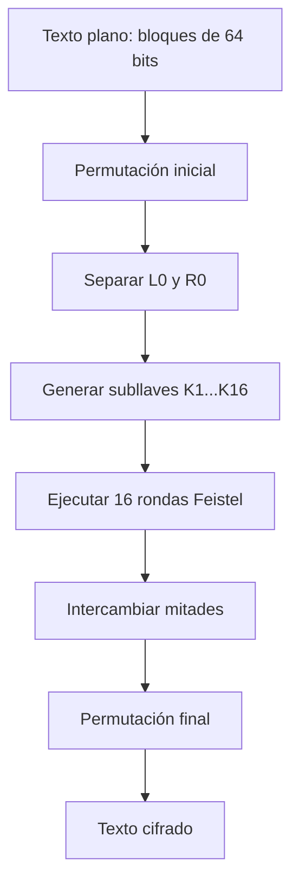
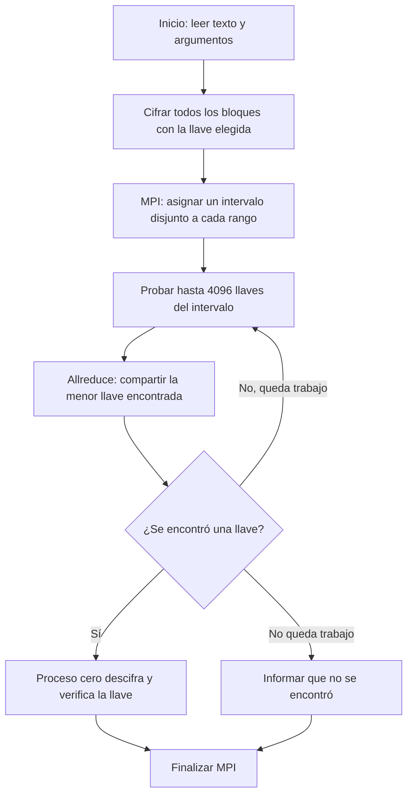
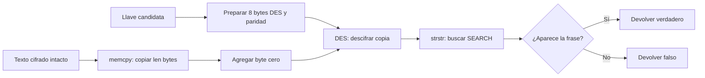
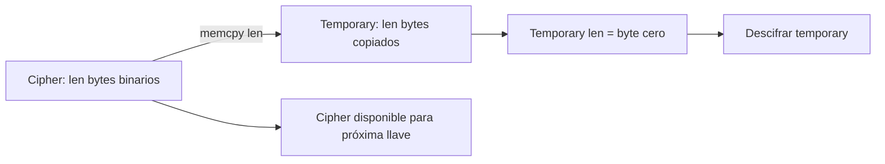

# Informe

# Investigación y documentación de DES

## Funcionamiento de DES

DES (Data Encryption Standard) es un algoritmo simétrico de cifrado por bloques. Utiliza una llave de 64 bits, de los cuales 56 son efectivos y 8 se emplean para paridad. El texto se divide en bloques de 64 bits, equivalentes a 8 bytes.

Cada bloque pasa por:

1. Permutación inicial.
2. División en dos mitades de 32 bits: izquierda y derecha.
3. Dieciséis rondas Feistel.
4. Intercambio de las mitades.
5. Permutación final.

En cada ronda, la mitad derecha se expande de 32 a 48 bits, se combina mediante XOR con una subllave, atraviesa las cajas S y la permutación P. Luego se combina con la mitad izquierda para generar la nueva mitad derecha.

Para descifrar se utiliza el mismo procedimiento, pero aplicando las subllaves en orden inverso.

## Diagrama de flujo de DES



## Función `encrypt(key, *ciph, len)`

En la implementación actual, la función recibe una llave numérica, un puntero al búfer de texto y su longitud:

```c
encrypt(uint64_t key, char *text, size_t len)
```

Primero convierte la llave efectiva de 56 bits en ocho bytes compatibles con DES. Después establece los bits de paridad mediante `des_setparity`. Finalmente llama a `ecb_crypt` con el modo `DES_ENCRYPT`. La función cifra todos los bloques del búfer y modifica directamente el contenido original.

## Función `decrypt(key, *ciph, len)`

`decrypt` realiza el mismo procedimiento de preparación de la llave, pero llama a `ecb_crypt` usando `DES_DECRYPT`. El búfer cifrado se transforma nuevamente en texto plano. La función devuelve un valor verdadero si la operación termina correctamente y falso si ocurre un error.

## Documentación del proceso de cifrado 

El programa inicia leyendo el archivo `texto_plano.txt` en modo binario. Esto permite conservar exactamente los bytes del mensaje. Luego calcula una longitud múltiplo de ocho, porque DES cifra bloques de 64 bits, equivalentes a ocho bytes. Si el texto no completa el último bloque, se agregan espacios hasta alcanzar ese tamaño y se reserva un byte adicional para el terminador de cadena.

Antes de llamar a la biblioteca DES, `encrypt` recibe la llave candidata, el puntero al búfer y su longitud. La función delega en `crypt_buffer` con el modo `DES_ENCRYPT`. Allí `key_to_des` separa la llave numérica en ocho grupos de siete bits, los coloca en los bytes correspondientes y desplaza cada grupo para dejar espacio al bit de paridad. Después `des_setparity` calcula y establece la paridad requerida por DES. Finalmente, `ecb_crypt` procesa el búfer completo en bloques de ocho bytes. Cada bloque pasa por la permutación inicial, las dieciséis rondas Feistel y la permutación final; el resultado reemplaza el texto original en memoria.

Durante una ronda Feistel, el bloque se divide en mitades izquierda y derecha de 32 bits. La mitad derecha se expande a 48 bits, se combina mediante XOR con una subllave, atraviesa las cajas S y la permutación P. Ese resultado se combina con la mitad izquierda para producir la nueva derecha, mientras la derecha anterior se convierte en la nueva izquierda. Las subllaves se usan en orden ascendente durante el cifrado.

Para descifrar, `decrypt` repite exactamente la preparación de la llave y llama a `crypt_buffer` con `DES_DECRYPT`. DES conserva la misma estructura de rondas, pero utiliza las subllaves en orden inverso. Por eso el búfer cifrado puede restaurarse sin implementar un algoritmo diferente. En la búsqueda de fuerza bruta, `try_key` copia primero el cifrado, aplica `decrypt` a la copia y busca la frase conocida. Si la encuentra, la llave se considera válida. Finalmente, el proceso cero descifra el búfer original con la llave ganadora y muestra el texto recuperado.

Ambas funciones devuelven uno si `ecb_crypt` finaliza correctamente y cero si ocurre un error; por eso el programa puede detectar fallos durante el procesamiento del búfer cifrado.

# Implementación y análisis del código

## Preparación del programa y del texto de prueba

El archivo `texto_plano.txt` contiene 355 palabras y 2192 bytes. Incluye literalmente `la busqueda distribuida termina cuando aparece la frase clave`, que es la constante `SEARCH` usada por ambos programas. El texto se lee en modo binario y se rellena con espacios hasta una longitud múltiplo de ocho bytes, requisito de los bloques DES. Se reserva además un byte `\0` fuera de la longitud cifrada. En este caso, 2192 ya es múltiplo de ocho.

Se corrigió `bruteforce_.c` como referencia secuencial: lee el mismo archivo que la versión MPI, cifra **todos** sus bloques, prueba las llaves del intervalo `[0, limite)` y muestra la llave y el texto recuperado. El código inicial tenía una llave fija de valor `2^54`, cifraba únicamente 16 bytes y comprobaba una frase que no aparecía en esos 16 bytes; así no permitía una prueba breve y válida con este texto. Ambos programas aceptan `--key N` y `--limit N`; por defecto usan llave 900000 y límite 1000000. Se exige `0 <= llave < limite <= 2^56`, porque DES tiene 56 bits efectivos de llave. El límite reducido hace reproducible la demostración: recorrer el espacio completo de DES no es una prueba práctica.

En un entorno Linux con compiladores y bibliotecas de OpenMPI y libtirpc instalados, desde el directorio que contiene `texto_plano.txt` se pueden usar:

```bash
mpicc -std=c11 -O2 -Wall -Wextra -I/usr/include/tirpc bruteforce_.c -ltirpc -o bruteforce_serial
mpicc -std=c11 -O2 -Wall -Wextra -I/usr/include/tirpc bruteforce_mpi.c -ltirpc -o bruteforce_mpi
./bruteforce_serial --key 63 --limit 256
mpirun -np 4 ./bruteforce_mpi --key 63 --limit 256
```

La primera orden usa `mpicc` también para el programa secuencial por comodidad; ese archivo no llama a MPI y puede compilarse con `cc` si encuentra los mismos encabezados y bibliotecas DES. La ruta de inclusión puede variar según la instalación. Se debe comprobar `LLAVE=63`, `VERIFICACION=CORRECTA` y que `TEXTO_DESCIFRADO` contenga el mensaje de entrada. Para probar distintos segmentos del reparto, son útiles `--key 0 --limit 8192`, `--key 4097 --limit 8192` y `--key 8191 --limit 8192` con cuatro procesos. Con ese límite, los intervalos esperados son `[0,2048)`, `[2048,4096)`, `[4096,6144)` y `[6144,8192)`.

## Paralelización mediante OpenMPI

`MPI_Init` crea la ejecución distribuida; `MPI_Comm_size` obtiene el número de procesos y `MPI_Comm_rank` identifica cada proceso. Cada rango carga el mismo texto plano y lo cifra con la llave indicada, de modo que todos prueban exactamente el mismo texto cifrado. Esto supone acceso al archivo desde cada proceso. El espacio `[0, limite)` se divide en intervalos contiguos y **disjuntos**. Si `base = limite / procesos` y `extra = limite % procesos`, cada uno de los primeros `extra` procesos recibe una llave adicional. Así se cubren todas las llaves sin omisiones ni duplicaciones, incluso cuando el límite no es divisible entre procesos.

Dentro de su intervalo, cada proceso ejecuta `try_key` para cada candidata. Tras cada bloque de hasta 4096 candidatas, todos participan en `MPI_Allreduce` con `MPI_MIN`. El valor especial `UINT64_MAX` significa «todavía no se encontró». Si algún proceso halló una llave, la reducción devuelve la menor llave encontrada a todos los procesos y todos salen del ciclo en el mismo punto de sincronización. Los procesos que terminaron su intervalo siguen participando en las colectivas hasta que los demás terminen o aparezca una llave; esto evita que un proceso quede esperando solo. `MPI_Reduce` obtiene el máximo tiempo local, que representa el tiempo total de la fase paralela. El proceso cero descifra, imprime el resultado y compara la llave hallada con la llave usada para cifrar.



## Función `tryKey(key, *ciph, len)`

En `bruteforce_.c` la función se llama `tryKey`; en `bruteforce_mpi.c` se llama `try_key`. Ambas reciben una llave numérica candidata, un puntero de solo lectura al texto cifrado y su longitud en bytes. Devuelven verdadero únicamente si DES pudo descifrar y `strstr` localizó la frase `SEARCH` en el resultado. `key_to_des` distribuye los 56 bits efectivos en ocho bytes y `des_setparity` establece los bits de paridad. `crypt_buffer` llama a `ecb_crypt` con `DES_DECRYPT | DES_SW`, aplicando DES a todos los bloques. El texto cifrado original permanece intacto para la siguiente candidata.

La función crea `temporary[len + 1]`, copia `len` bytes del cifrado, escribe el terminador `temporary[len] = '\0'`, descifra **solo** la copia y busca la frase. El terminador es necesario para usar una función de cadenas tras el descifrado. Si una llave equivocada produce por casualidad un byte cero antes de la frase, `strstr` no verá el resto, lo cual es adecuado para descartar esa candidata. La aparición accidental de toda la frase con otra llave es extremadamente improbable; además, la salida compara explícitamente la llave recuperada con la usada para cifrar. El arreglo temporal está en la pila, por lo que esta implementación supone un texto de tamaño moderado.



## Función `memcpy()`

`memcpy(destino, origen, cantidad)` copia exactamente `cantidad` **bytes** de `origen` a `destino` y devuelve `destino`. No interpreta caracteres ni añade `\0`. Por eso se copia `len` y se escribe el terminador por separado. `temporary` tiene capacidad `len + 1`, y `cipher` conserva al menos `len` bytes válidos. Los rangos de origen y destino no se superponen; si se superpusieran, correspondería `memmove`. En este programa la copia evita que el intento de una llave destruya el cifrado que necesitan los intentos siguientes. Como el cifrado puede contener bytes cero, una copia basada en `strlen` o `strcpy` sería incorrecta.



## Función `strstr()`

`strstr(cadena, subcadena)` devuelve un puntero al primer lugar donde aparece `subcadena`, o `NULL` si no aparece. Exige que ambos argumentos sean cadenas terminadas en cero; no recibe una longitud y no sirve para buscar directamente dentro del cifrado binario. Aquí se llama después de descifrar y después de garantizar `temporary[len] = '\0'`. La expresión `strstr(temporary, SEARCH) != NULL` convierte el resultado en una condición booleana. Encontrar la frase conocida actúa como criterio de reconocimiento del texto recuperado; no cambia ni copia el texto.

## Verificación y límites de esta ejecución

Se revisaron el tamaño y el contenido de `texto_plano.txt`: tiene 355 palabras, 2192 bytes, longitud múltiplo de ocho y la frase exacta de búsqueda. Una comprobación independiente con la implementación DES de OpenSSL descifró el texto cifrado para las llaves 0, 63 y 255, buscó la misma frase entre las candidatas `[0,256)` y obtuvo respectivamente las llaves 0, 63 y 255. En los tres casos los 2192 bytes recuperados coincidieron con los bytes originales. Esta comprobación valida los datos de entrada, la transformación de la llave y el criterio de búsqueda; **no equivale a ejecutar los programas C**.

En el entorno usado para esta revisión no están disponibles `mpicc`, `mpirun` ni el encabezado `rpc/des_crypt.h`. Además, la instalación local de GCC termina con error incluso al compilar un programa mínimo, por lo que no fue posible compilar ni ejecutar `bruteforce_.c` o `bruteforce_mpi.c` aquí. Las órdenes anteriores quedan preparadas para repetir la compilación y verificar la ejecución MPI en un equipo con esas dependencias. Los tiempos y el speedup deben medirse allí; no se presentan cifras de rendimiento no observadas.
## Corrección de compilación en WSL: biblioteca DES

Durante la compilación en WSL, el enlazador informó referencias indefinidas a `des_setparity` y `ecb_crypt`. Aunque `libtirpc-dev` proporciona el encabezado `rpc/des_crypt.h`, la biblioteca disponible en ese entorno no resolvió esas funciones. Se reemplazó ese backend por las funciones DES de OpenSSL en **ambos** programas: `DES_set_odd_parity`, `DES_set_key_unchecked` y `DES_ecb_encrypt`. `crypt_buffer` transforma cada bloque de ocho bytes y conserva el mismo esquema DES-ECB y la misma búsqueda de la frase conocida. Las explicaciones anteriores de `memcpy`, `strstr`, `tryKey` y la distribución MPI siguen describiendo el flujo; las referencias anteriores a `des_setparity` y `ecb_crypt` corresponden a la versión previa del backend.

Para la versión corregida, se instala `libssl-dev` y se enlaza con `-lcrypto`:

```bash
sudo apt install build-essential openmpi-bin libopenmpi-dev libssl-dev
gcc -std=c11 -O2 bruteforce_.c -lcrypto -o bruteforce_serial
mpicc -std=c11 -O2 bruteforce_mpi.c -lcrypto -o bruteforce_mpi
./bruteforce_serial --key 63 --limit 256
mpirun -np 4 ./bruteforce_mpi --key 63 --limit 256
```

Al compilar con OpenSSL 3 pueden aparecer avisos de API DES obsoleta; son advertencias de compilación y no errores de enlace. Se conserva DES aquí porque es el algoritmo solicitado para el ejercicio. La ejecución se debe realizar desde el directorio donde se encuentra `texto_plano.txt`.
### Resultado de la compilación y ejecución real en WSL

Después de instalar `libssl-dev` en WSL (Ubuntu), se compilaron correctamente `bruteforce_.c` con `gcc` y `bruteforce_mpi.c` con `mpicc`, enlazando ambos con `-lcrypto`. OpenSSL 3 emitió únicamente avisos por las funciones DES obsoletas; los dos enlazados terminaron con código cero. Las pruebas se ejecutaron desde la carpeta del proyecto, con el archivo `texto_plano.txt` presente y el límite de 256 llaves.

| Llave usada | Secuencial | MPI con 4 procesos |
|---:|---|---|
| 0 | `LLAVE=0`, `VERIFICACION=CORRECTA`, salida 0 | `LLAVE=0`, `VERIFICACION=CORRECTA`, salida 0 |
| 63 | `LLAVE=63`, `VERIFICACION=CORRECTA`, salida 0 | `LLAVE=63`, `VERIFICACION=CORRECTA`, salida 0 |
| 255 | `LLAVE=255`, `VERIFICACION=CORRECTA`, salida 0 | `LLAVE=255`, `VERIFICACION=CORRECTA`, salida 0 |

La prueba MPI con llave 63 mostró los intervalos `[0,64)`, `[64,128)`, `[128,192)` y `[192,256)`. La observación anterior de que no se podían compilar o ejecutar los programas correspondía al entorno Windows inicial; esta prueba posterior en WSL la reemplaza. Los tiempos de esta prueba breve no constituyen una medición de rendimiento o speedup.